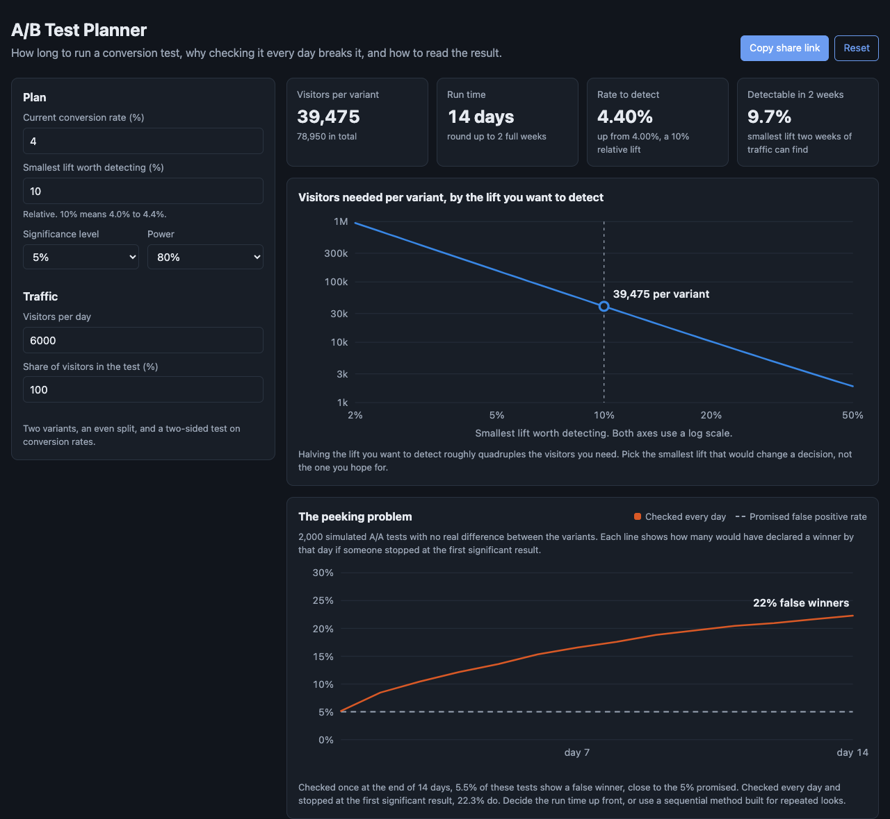

# A/B Test Planner

A browser tool for conversion experiments, from planning to readout. It tells you how many visitors a test needs and how long to run it, shows with a simulation why checking results every day produces false winners, and reads a finished test with a confidence interval and a sample ratio check.



## Why

Most A/B testing mistakes happen before or after the statistics, not inside them:

- **Underpowered tests.** A team hopes for a 2% lift, plans for one week, and calls the result flat. The test could never have detected the lift they cared about.
- **Peeking.** Someone checks the dashboard daily and ships the variant the first day it shows "95% significant". With a fixed-horizon test, that inflates the false positive rate several times over.
- **Broken splits.** A redirect or a logging bug sends 51% of traffic to one variant. The numbers look precise and mean nothing.

This tool puts each of those in front of the person planning or reading the test.

## What it does

**Plan.** Enter the current conversion rate, the smallest relative lift worth detecting, the significance level, power, and traffic. You get visitors per variant, the run time in days and rounded up to whole weeks so every weekday is counted equally, and the smallest lift two weeks of traffic could detect. A log-log chart shows how the sample grows as the lift shrinks, with a hover readout of the days each lift would take.

**Peeking.** 2,000 simulated A/A tests, where the variants are identical, run for the planned duration. The chart shows the share that would have declared a winner by each day if someone stopped at the first significant result. With the defaults, one look at the end gives about 5% false winners, as promised. Looking every day for two weeks gives about 22%.

**Read a result.** Enter visitors and conversions for each variant. You get both rates, the relative lift with its confidence interval drawn against "no change", the p-value, and a verdict. A chi-square sample ratio check runs first. If the visitor split is too uneven to be chance, the verdict says not to trust the result, whatever the p-value says. The tool also notes when a test is being read before it reached its planned sample.

## The math

- Sample size uses the standard formula for a two-sided z-test on two proportions. A test checks it against the textbook value: 3,841 per group to detect 10% versus 12% at 5% significance and 80% power.
- The p-value comes from a pooled two-proportion z-test. The interval for the absolute difference is unpooled. The interval for the relative lift uses the delta method on the log of the ratio, so it is not symmetric, which is correct for a ratio.
- The normal CDF and its inverse are implemented directly: Numerical Recipes' `erfc` and Acklam's inverse, both accurate well past what this needs.
- The peeking simulation uses a seeded random generator, so it shows the same numbers every time for the same inputs.

## Run it

It is a static site with no build step and no dependencies.

- **GitHub Pages:** enable Pages for the repo and serve from the root of the default branch.
- **Locally:** ES modules need a web server, so `file://` will not work. From this folder run:

```bash
python3 -m http.server 8000
```

Then open http://localhost:8000.

## Tests

The statistics live in `src/stats.js` with no DOM code, so they run under Node's built-in test runner.

```bash
npm test
```

12 tests check the normal functions against table values, the sample size against the textbook example, duration and detectable lift, the readout's z, p-value, and intervals, zero-conversion edge cases, the sample ratio check, and that daily peeking inflates false positives while a fixed horizon stays near alpha.

## License

MIT. See [LICENSE](LICENSE).
